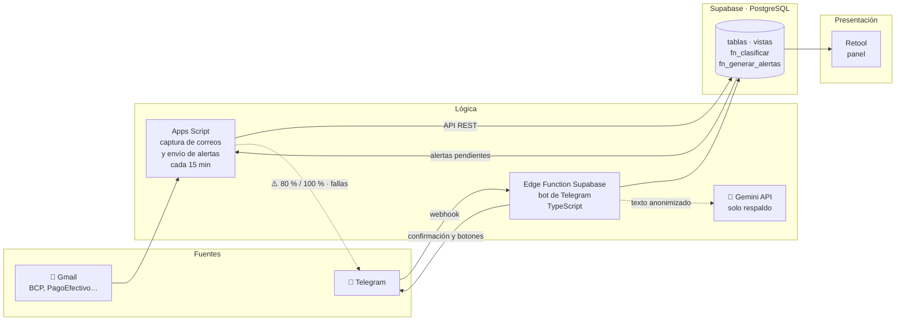
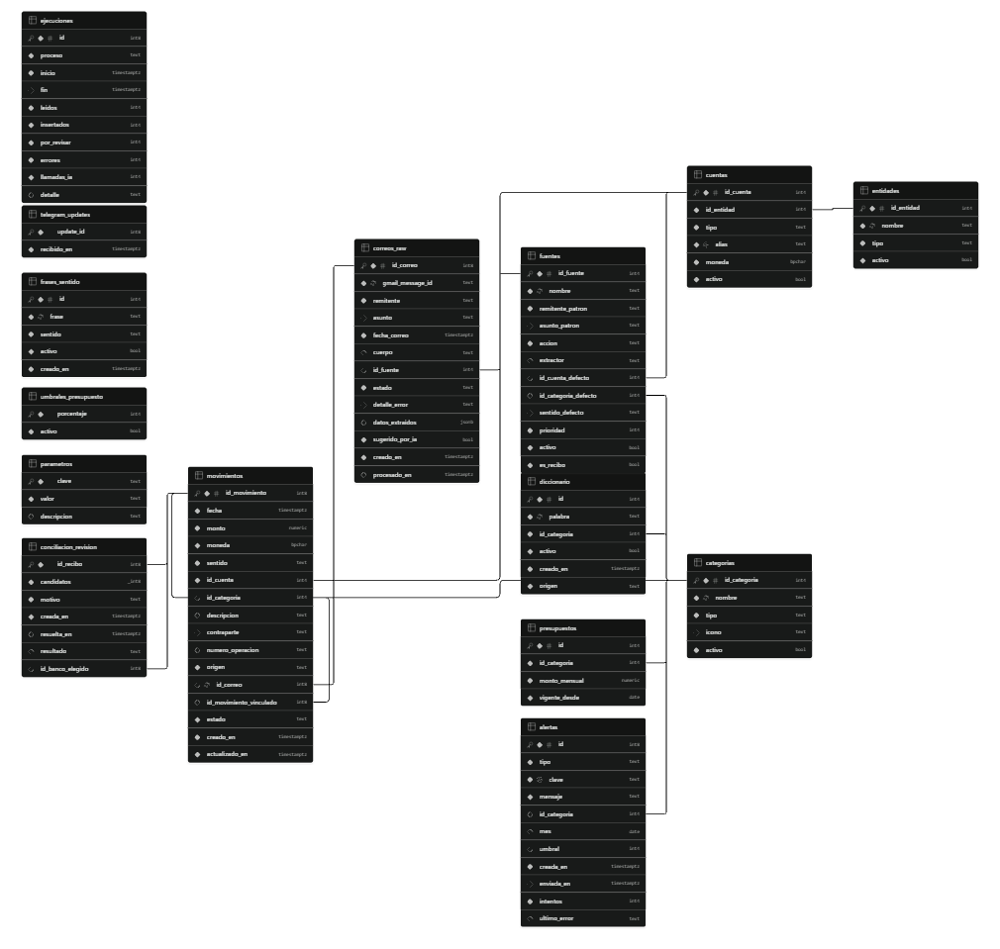
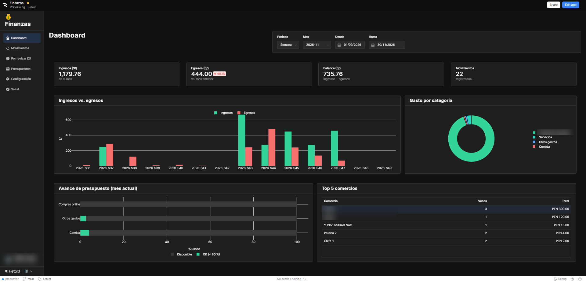
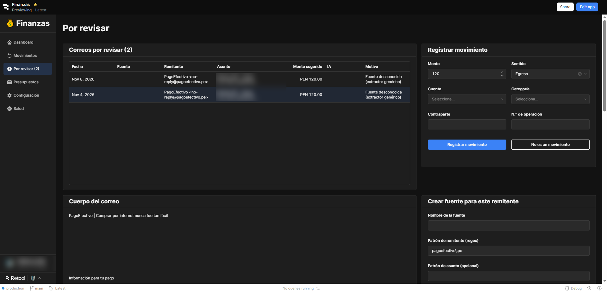
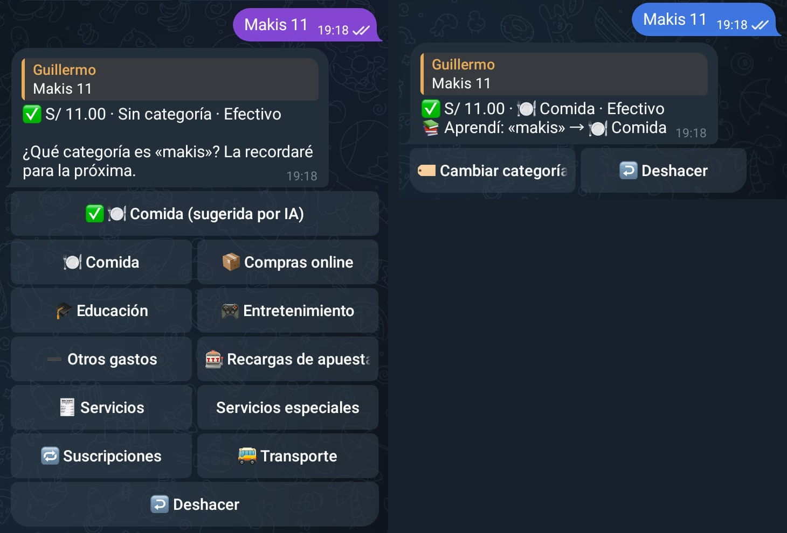
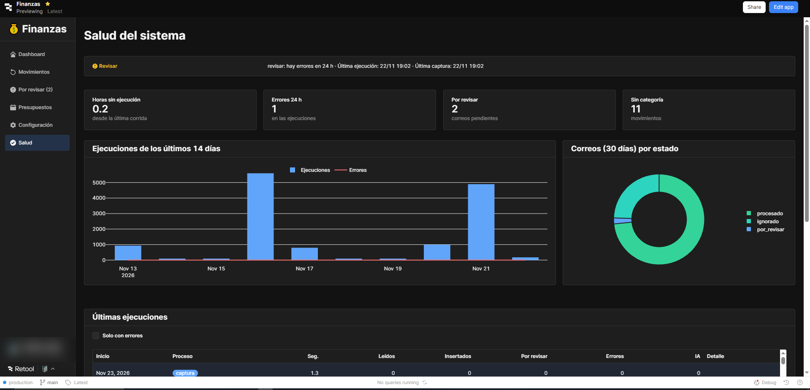

# Finanzas personales automatizadas

Sistema en la nube que **captura mis movimientos de dinero desde los correos del banco**, me deja **registrar por Telegram** lo que el banco no ve (efectivo, Yape enviados), los **clasifica**, los guarda en **PostgreSQL**, los muestra en un **panel** con presupuestos y me **avisa por Telegram** si me acerco al límite o si algo falla. Funciona solo, 24/7, sin depender de mi PC y con servicios gratuitos.

> Proyecto personal de aprendizaje en datos/BI. Todo lo que se ve en este repositorio y en las capturas son **datos de demostración ficticios** (`sql/demo/datos_demo.sql`).

<!-- CAPTURA: GIF de 15–20 s: escribir "pasaje 3, menu 12" en Telegram → confirmación con botones → el gasto aparece en el panel. Guardar como docs/img/demo.gif -->


---

## 1. El problema

Mis movimientos estaban dispersos: correos del BCP, Yape y efectivo. Los Yape **enviados** y el efectivo no generan ningún correo, así que no sabía con claridad en qué gastaba. Antes tenía un script que copiaba algunos correos a una hoja de cálculo, sin validaciones, sin categorías y con duplicados si se ejecutaba dos veces.

**Objetivo:** registrar todos los ingresos y gastos con la menor intervención manual posible, sin perder ni duplicar ningún correo, y poder analizarlos y corregirlos.

## 2. Arquitectura

Arquitectura en capas, *serverless*, con un pipeline ETL dirigido por eventos (activador cada 15 min y mensajes del bot).



<!-- CAPTURA (opcional): exportar este diagrama o uno propio a docs/img/arquitectura.png -->

| Capa | Componente | Responsabilidad |
|---|---|---|
| Fuentes | Gmail, Telegram | Correos de notificación del banco y apps; mensajes como `pasaje 3` |
| Lógica | Apps Script (`apps_script/`) | Lee Gmail, identifica la fuente, extrae monto/fecha/operación, clasifica y carga. Envía las alertas por Telegram |
| Lógica | Edge Function (`supabase/functions/telegram-webhook/`) | Bot: interpreta el mensaje, registra, botones de corrección y deshacer, comandos `/hoy`, `/semana`, `/mes`, `/presupuesto` |
| Datos | Supabase (`sql/`) | Tablas con restricciones, vistas de reporte y las reglas compartidas (`fn_clasificar`, `frases_sentido`, `fn_generar_alertas`) |
| Presentación | Retool | Dashboard, movimientos, "Por revisar", presupuestos, configuración y salud del sistema |
| Apoyo | Gemini API | Solo cuando las reglas no entienden un mensaje: **propone, yo confirmo** |

### Flujo de captura de un correo

1. Busca correos de remitentes conocidos de los últimos 10 días (si el activador se detuvo, se pone al día solo).
2. Si el `gmail_message_id` ya existe en la base, lo salta (**idempotencia**).
3. Guarda el correo original en `correos_raw` (trazabilidad y reprocesamiento sin volver a Gmail).
4. Identifica la fuente con la tabla `fuentes` (expresiones regulares de remitente y asunto) y aplica su extractor.
5. Clasifica con `fn_clasificar` y guarda el movimiento.
6. Si algo falla en un correo, ese correo queda `por_revisar` o `error` con el motivo, y **los demás se siguen procesando**.
7. Registra la corrida en `ejecuciones` (leídos, insertados, errores).

### Modelo de datos

<!-- CAPTURA: diagrama entidad-relación desde Supabase (Database → Schema Visualizer). Guardar como docs/img/modelo.png -->


- `movimientos` es la tabla central: **una sola** para todos los bancos y billeteras. Agregar un banco nuevo es insertar filas en `entidades`, `cuentas` y `fuentes`, no crear tablas.
- Catálogos de configuración: `entidades`, `cuentas`, `categorias`, `diccionario`, `fuentes`, `frases_sentido`, `presupuestos`, `umbrales_presupuesto`, `parametros`.
- Operación y monitoreo: `correos_raw`, `ejecuciones`, `telegram_updates`, `alertas` (bandeja de salida de avisos).
- Vistas: `v_gasto_mensual`, `v_gasto_categoria_mes`, `v_avance_presupuesto`, `v_salud_sistema` (todas sobre `v_movimientos_contables`, que excluye anulados, recibos conciliados y transferencias entre cuentas propias).

## 3. Decisiones técnicas y su porqué

| Decisión | Por qué | Alternativa descartada |
|---|---|---|
| **PostgreSQL (Supabase)** en vez de Google Sheets | Base real: `UNIQUE`, `CHECK`, claves foráneas, vistas y funciones. Las reglas de datos las hace cumplir la base, no el código | Sheets: sin restricciones, duplicados silenciosos |
| **Apps Script** para leer correos | Acceso nativo a Gmail, corre gratis en la nube con activadores | Power Automate: sin licencia útil |
| **Edge Function** para el bot (no Apps Script) | Medido: Apps Script responde al webhook con un 302 y tardaba 2–3 s, Telegram reintentaba y se trababa; la Edge Function responde en ~0,6–0,9 s | Bot en Apps Script (archivado en `apps_script/archivo_bot_apps_script/` con el motivo) |
| **Reglas antes que IA** | Gratis, predecible y explicable. La IA solo actúa cuando las reglas no entienden, propone y yo confirmo. Si falla o se acaba la cuota, el sistema sigue funcionando | IA para todo: costo, latencia (~5 s) y errores no explicables |
| **Una sola regla de clasificación en SQL** (`fn_clasificar`) | Antes la misma lógica estaba escrita en Apps Script y en el bot; un cambio en una y no en la otra daba categorías distintas para el mismo texto | Duplicar la lógica en cada cliente |
| **Configuración en tablas** (`fuentes`, `diccionario`, `frases_sentido`, `presupuestos`, `umbrales_presupuesto`, `parametros`) | Agregar un banco, una palabra o una frase es un `INSERT` (o una edición en Retool), sin volver a desplegar código | Listas y regex escritas en el código |
| **Alertas: SQL decide, Apps Script envía** (`fn_generar_alertas` + tabla `alertas`) | La regla (qué umbral se cruzó, qué ya se avisó) vive en un solo lugar y se prueba en SQL. Cada aviso tiene una clave `UNIQUE` (`presupuesto:2026-11:cat3:80`), así nunca se repite; se marca como enviado **después** de que Telegram confirma, así un fallo de red no lo pierde (patrón *outbox*). Corre en un activador aparte del de captura para poder avisar si la captura se detiene | Enviar desde un trigger de PostgreSQL (`pg_net`): el token del bot quedaría en la base y un fallo de red haría fallar el `INSERT` del gasto |
| **Retool** como panel | Se alimenta de mis propias consultas SQL y permite **editar** datos (corregir categorías, resolver "Por revisar") | Grafana (no edita), Streamlit (estética básica) |
| **Telegram** en vez de WhatsApp | Gratis y el bot se crea en minutos | WhatsApp exige la API empresarial de Meta |
| `NUMERIC(12,2)` y montos siempre positivos | Exactitud con dinero; el signo lo da la columna `sentido` | `FLOAT` (errores de redondeo) |
| `TIMESTAMPTZ` y reportes en `America/Lima` | Un gasto del 31/10 a las 23:00 en Lima ya es 01/11 en UTC; sin convertir, caería en otro mes | Guardar texto o hora local sin zona |
| Borrado lógico (`estado = 'anulado'`, `activo = false`) | Se puede deshacer y auditar | `DELETE` |

## 4. Confiabilidad: cómo evita duplicados y pérdidas

| Situación | Qué hace el sistema |
|---|---|
| El mismo correo se lee dos veces | `correos_raw.gmail_message_id` es `UNIQUE`; `movimientos.id_correo` es `UNIQUE` |
| El banco reenvía la misma operación | Índice único parcial `(id_cuenta, numero_operacion)` |
| Telegram reenvía el mismo mensaje | `telegram_updates.update_id` es `PRIMARY KEY` |
| Supabase no responde | El correo no se marca como procesado y se reintenta en la siguiente corrida |
| Correo con formato nuevo | Va a "Por revisar" con datos prellenados; el resto sigue |
| El activador se detiene unos días | Ventana de 10 días hacia atrás: al volver se pone al día |
| El plan gratuito pausa la base tras días sin actividad | La captura cada 15 min escribe en `ejecuciones`, así la base nunca queda inactiva |
| La captura falla o deja de correr | Aviso por Telegram: corrida con errores o cortada (uno cada 6 h como máximo, con el resumen) y "no corre hace 3 h" (una vez por caída). También `v_salud_sistema` en el panel |
| Una alerta se generaría dos veces | `alertas.clave` es `UNIQUE`: "Comida, noviembre, 80 %" se avisa una sola vez. Si un gasto salta de 70 % a 110 %, llega solo el de 100 % |
| Telegram no responde | La alerta queda pendiente y se reintenta cada 15 min (máximo 5 intentos, configurable) |
| Dos ejecuciones se cruzan | `LockService`: la segunda espera o se salta |
| Registro a mano un Yape que ya llegó por correo | El bot detecta el mismo monto, día y cuenta y pregunta "¿Es el mismo?" |
| El mismo gasto llega por dos fuentes (recibo de la app y consumo del banco) | El modelo ya lo soporta: el recibo apunta al movimiento bancario (`id_movimiento_vinculado`) y las vistas no lo suman. La vinculación automática está en los siguientes pasos |

## 5. Seguridad y privacidad

- **Ninguna clave está en el código.** Apps Script las lee de *Propiedades del script* (`SUPABASE_URL`, `SUPABASE_KEY`, `TELEGRAM_TOKEN`, `TELEGRAM_CHAT_ID`); si falla el envío a Telegram, el token se reemplaza por `***` antes de guardar el error; la Edge Function, de *Edge Functions → Secrets* (`TELEGRAM_TOKEN`, `TELEGRAM_CHAT_ID`, `TELEGRAM_SECRETO`, `GEMINI_KEY`).
- **RLS activado sin políticas** en todas las tablas y permisos solo para `service_role`: las claves públicas (`anon`) no pueden leer ni escribir nada.
- Las funciones usan `SET search_path = ''` y se revoca `EXECUTE` a `PUBLIC` (en PostgreSQL, a diferencia de SQL Server, toda función nueva la puede ejecutar cualquiera).
- El bot valida un **secreto en la cabecera** del webhook y **solo responde a mi `chat_id`**.
- Antes de enviar texto a Gemini se **anonimiza**: números largos (tarjeta, cuenta, celular) y direcciones de correo.
- El sistema **solo lee** Gmail: no borra ni mueve correos.
- En este repositorio **solo hay datos de demostración**. `.gitignore` excluye `.clasp.json`, `.env`, credenciales y notas privadas.

## 6. Pruebas

| Qué | Cómo se ejecuta | Resultado |
|---|---|---|
| Lógica del bot (interpretar `pasaje 3`, `queque .2`, `me han yapeado 5`, validación de la IA, anonimización…) | `node --experimental-strip-types supabase/functions/telegram-webhook/logica_test.ts` (o `deno run`) | 45/45 |
| Extractores de correos, fuentes, respaldo de clasificación y envío de alertas (cola, reintentos, token oculto) | En Apps Script: ejecutar `probarTodo` | 28/28 |
| Regla de clasificación y frases de ingreso/egreso | Bloques de prueba al final de `sql/09` y `sql/10` | `ok = true` |
| Alertas: 79 % no avisa, 80 % avisa una vez, no se repite, anulados no cuentan, salto directo a 100 %, errores con silencio, captura detenida | Bloque final de `sql/11` (crea datos de prueba y los deshace) | 12/12 |
| Usuario de Retool con permisos mínimos: sin DELETE, sin cambiar montos, RLS por filas, resolver "Por revisar" en una transacción | Bloque final de `sql/12` (permisos) y `sql/pruebas/12_rol_retool_pruebas.sql` (entra como el rol e intenta acciones prohibidas; termina en ROLLBACK) | 12/12 y 17/17 |
| Datos demo coherentes con el esquema y las reglas | `sql/demo/datos_demo.sql` corre 8 pruebas dentro de su transacción; si una falla, no deja nada | 8/8 |

## 7. Cómo desplegarlo

Requisitos: cuenta de Google, proyecto gratuito de Supabase, bot de Telegram (@BotFather) y clave de Gemini (Google AI Studio, opcional).

**1. Base de datos (Supabase → SQL Editor)**
Ejecuta en orden `sql/01_esquema.sql` … `sql/12_rol_retool.sql`. Todos son idempotentes: se pueden volver a correr sin duplicar nada.

**2. Datos de demostración (opcional, en una base aparte)**
Ejecuta `sql/demo/datos_demo.sql`. Genera 3 meses ficticios con fechas que siempre terminan en el mes actual. Tiene una guardia: si la base tiene un solo movimiento que no sea demo, se detiene sin tocar nada.

**3. Captura de correos (Apps Script)**
Ver [`apps_script/LEEME.md`](apps_script/LEEME.md). Resumen: crear el proyecto (o `clasp push`), cargar `SUPABASE_URL`, `SUPABASE_KEY`, `TELEGRAM_TOKEN` y `TELEGRAM_CHAT_ID` en Propiedades del script, ejecutar `probarTodo`, `probarConexion`, `crearActivador` y `crearActivadorAlertas`.

**4. Bot de Telegram (Edge Function)**
Ver [`supabase/functions/telegram-webhook/LEEME.md`](supabase/functions/telegram-webhook/LEEME.md). Resumen: desplegar la función, cargar los secretos, desactivar "Verify JWT" y registrar el webhook con `secret_token`.

**5. Panel (Retool)**
Ver [`docs/retool.md`](docs/retool.md). Resumen: ponerle contraseña al usuario `retool_panel` (creado por `sql/12`, con permisos mínimos), conectar Retool por el **Session pooler** (IPv4) y pegar las consultas de cada pantalla.

### Cómo agregar un banco o app nueva
1. `INSERT` en `entidades` y `cuentas` (si es una entidad nueva).
2. `INSERT` en `fuentes` con el regex de remitente y asunto, y el extractor (`generico` si no hay uno propio).
3. Solo si el formato es nuevo: un extractor en `Extractores.gs` con la misma interfaz y un caso en `Pruebas.gs`.

## 8. Capturas del panel

<!-- CAPTURA: Retool · Dashboard (gasto mensual, por categoría, avance de presupuesto). docs/img/panel_dashboard.png -->


<!-- CAPTURA: Retool · Por revisar (correo sugerido por IA). docs/img/panel_por_revisar.png -->


<!-- CAPTURA: Telegram · "pasaje 3, menu 12" con los botones [Cambiar categoría] [Deshacer]. docs/img/bot.png -->


<!-- CAPTURA: Retool · Salud del sistema. docs/img/panel_salud.png -->


## 9. Estructura del repositorio

```
├── README.md
├── apps_script/                     ← captura de correos (Google Apps Script, vía clasp)
│   └── archivo_bot_apps_script/     ← versión anterior del bot y por qué se cambió
├── supabase/functions/telegram-webhook/   ← bot (TypeScript) + pruebas
├── sql/
│   ├── 01_esquema.sql … 12_rol_retool.sql       ← migraciones numeradas e idempotentes
│   └── demo/datos_demo.sql          ← datos ficticios (nunca en la base real)
└── docs/img/                        ← capturas y GIF
```

## 10. Qué aprendí y siguientes pasos

- Diseñar para fallos (idempotencia, reintentos, monitoreo) importa más que el caso feliz.
- Poner las reglas de negocio en la base (`fn_clasificar`, tablas de configuración) evitó que dos programas se contradijeran.
- Medir antes de cambiar: el paso del bot a una Edge Function se decidió con tiempos de respuesta, no por preferencia.

**Siguientes pasos:** resumen semanal por correo, vigilancia externa con `pg_cron` (para avisar incluso si Google detiene todos los activadores), conciliación automática entre fuentes, gastos recurrentes, reporte en Power BI conectado a Supabase y nuevas fuentes según aparezcan.

---

Autor: Guillermo · Estudiante de Ingeniería de Sistemas e Informática (UNMSM).
<!-- Agrega aquí tu LinkedIn si quieres. -->
